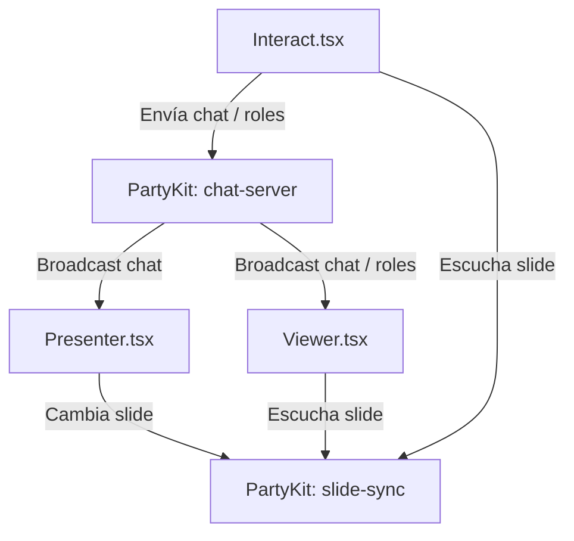

# Exploración: Conferencia Premium e Interactividad en Tiempo Real

Para lograr una experiencia premium en la conferencia de 45 minutos de Opita Code, se propone integrar un canal de interacción en tiempo real mediante PartyKit que sincronice al presentador, la pantalla de visualización (Viewer), los productos de Opita Code y los dispositivos móviles de la audiencia.

---

## 1. Arquitectura de Sincronización Doble

Para mantener una separación de conceptos limpia:
1. **Presentación (`slide-sync.ts`)**: Controla y persiste el estado de la diapositiva actual (`currentSlide`), el modo demo (`isDemoMode`) y si el QR está en pantalla completa (`isQRFullscreen`).
2. **Interactividad (`chat-server.ts` - Nueva Party)**: Maneja los mensajes de chat en tiempo real y el envío de perfiles/roles de la audiencia para la demo interactiva en la Diapositiva 7.

---

## 2. Experiencia de Usuario Móvil (`Interact.tsx`)

La audiencia escaneará el código QR visible en el deck (que apuntará a `https://d3k6c6srmxps7z.cloudfront.net/#/interact`).
Al entrar, se les presentará una interfaz web móvil optimizada:

- **Registro Rápido**: Ingresar un nombre/alias (guardado en `localStorage`).
- **Tarjeta Contextual (Sincronizada con la diapositiva actual)**:
  - **Diapositivas 1-4**: Bienvenida y enlaces a la web de Opita Code.
  - **Diapositiva 5 (Vibe Studio)**: Cupón dinámico "1 mes de Vibe Studio Pro gratis" con redirección y copia automática del cupón `OPITAVIBE45`.
  - **Diapositiva 6 (Ecosistema)**: Cupón dinámico "1 mes de Trabajos Pro gratis" con cupón `OPITATRABAJOS45`.
  - **Diapositiva 7 (Demo en Vivo)**: Formulario interactivo para enviar el rol/perfil de desarrollo.
  - **Diapositiva 8 (Cierre)**: Enlaces de redes sociales y feedback.
- **Chat en Tiempo Real**: Un chat persistente en la mitad inferior para enviar reacciones y preguntas al orador.

---

## 3. Experiencia Visual del Viewer (`Viewer.tsx`)

- **Chat Ticker / Overlay**: Los mensajes enviados por la audiencia flotarán en la esquina inferior izquierda con un diseño semi-transparente premium (estilo Twitch/Live stream) y se desvanecerán automáticamente tras 6 segundos para no obstruir el contenido.
- **Visualización de la Demo (Diapositiva 7)**: En lugar del texto plano "Esperando respuestas...", se mostrará una grilla dinámica en tiempo real con las respuestas y roles que envía la audiencia.
- **QR Siempre Disponible**: El QR en la barra superior se mantendrá apuntando a la ruta de interacción (`#/interact`) para que cualquier persona que llegue tarde pueda escanearlo y unirse inmediatamente.

---

## 4. Experiencia del Presentador (`Presenter.tsx`)

- **Chat Feed**: Se agregará una barra lateral colapsable en el panel de administración que le permita a Nico monitorear los comentarios y preguntas de la audiencia sin perder de vista sus notas de teleprompter ni los controles.
- **Monitoreo de Conexiones**: Ver cuántas personas están conectadas activamente en el chat.

---

## 5. Pruebas E2E (TDD)

Se diseñará una prueba en `tests/prod/interact.spec.ts` para verificar:
1. El envío de mensajes desde la vista de interacción y su correcta aparición en el Viewer.
2. El cambio en la tarjeta contextual móvil cuando el presentador avanza de diapositiva.
3. El procesamiento y visualización de roles de la demo interactiva en la Diapositiva 7.
