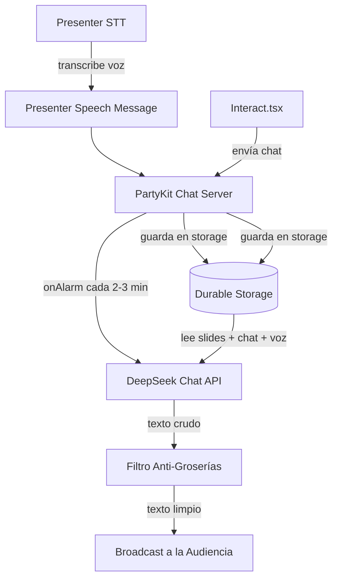

# Exploración: Bot Inteligente, Moderación Estricta y QR Dinámico

Este documento explora las soluciones técnicas para dos necesidades críticas en la plataforma:
1. **Corrección del QR de Interacción**: El QR actualmente redirige a la raíz de la web en lugar del chat interactivo debido a una discrepancia entre la URL inicial de PartyKit y la URL de la aplicación.
2. **Chatbot Inteligente de Audiencia (OpitaBot)**: Un asistente virtual que intervenga de forma pausada (cada 2 a 3 minutos), diciendo solo lo necesario y reaccionando tanto al chat de la audiencia como al discurso en vivo del presentador, manteniendo una moderación impecable.

---

## 1. Diagnóstico del Redireccionamiento del QR

### Causa Raíz:
- En `party/slide-sync.ts`, el estado inicial por defecto (`DEFAULT_STATE`) inicializa `qrUrl` como `https://d3k6c6srmxps7z.cloudfront.net` (sin fragmento de ruta).
- Al sincronizarse, este valor sobrescribe el valor predeterminado del cliente (`https://d3k6c6srmxps7z.cloudfront.net/#/interact`), haciendo que el QR renderizado carezca de la ruta `/interact`.
- Adicionalmente, el QR no pasa de forma dinámica el identificador de la sala (`room`), lo que causaría desincronización si se usa una sala personalizada (ej. `?room=neiva2026`).

### Solución Propuesta:
- Corregir el valor por defecto en `party/slide-sync.ts` a `https://d3k6c6srmxps7z.cloudfront.net/#/interact`.
- En `Presenter.tsx` y `Viewer.tsx`, calcular dinámicamente la URL en base a `window.location.origin` y los parámetros de la URL actual para asegurar que la redirección funcione en desarrollo local (`http://localhost:5173`) y producción, y propague el parámetro `room` (ej. `https://d3k6c6srmxps7z.cloudfront.net/?room=neiva#/interact`).

---

## 2. Arquitectura del Bot de Chat Inteligente (OpitaBot)

Para que el bot hable cada 2 o 3 minutos con criterio y de forma contextualizada, diseñamos un sistema basado en eventos y alarmas persistentes.

### Componentes Clave:
1. **Captura de Voz del Presentador**:
   - En `Presenter.tsx`, cuando la transcripción intermedia de Deepgram se hace final (`received.is_final`), se envía al servidor mediante el WebSocket de chat con el tipo `presenter_speech`.
   - El servidor almacena los últimos 10 enunciados del orador en el buffer `presenter_speech` del Durable Storage.
2. **Petición al LLM (DeepSeek)**:
   - Al dispararse la alarma, el servidor reúne el historial de chat reciente (últimos 15 mensajes), el buffer de discurso del orador y el slide actual.
   - Envía esta información en un system prompt optimizado a `https://api.deepseek.com/chat/completions` utilizando `DEEPSEEK_API_KEY` (configurada en el entorno de PartyKit).
3. **Filtro de Seguridad de Dos Capas (Moderación)**:
   - **Capa Semántica**: El system prompt instruye estrictamente al LLM a no utilizar lenguaje vulgar, modismos groseros ni comentarios fuera de lugar, limitándose a una intervención amigable de 1 o 2 frases.
   - **Capa Programática (Regex)**: El servidor pasa la respuesta generada por el regex `BAD_WORDS_REGEX` y reemplaza cualquier término prohibido por un emoji de marca, actuando como filtro definitivo.

---

## 3. Pruebas y Robustez
- Si la API de DeepSeek está caída, expira o no tiene fondos, el servidor cuenta con un fallback local basado en reglas pre-configuradas según el slide activo y el chat, garantizando que el bot continúe activo sin arrojar excepciones.
